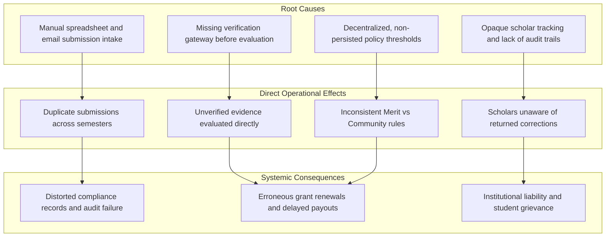
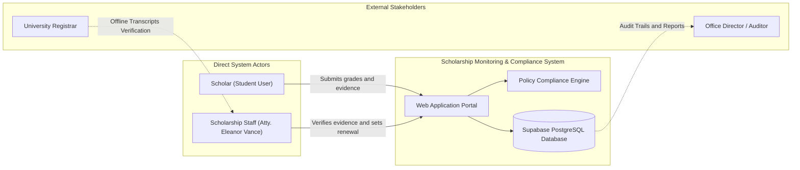
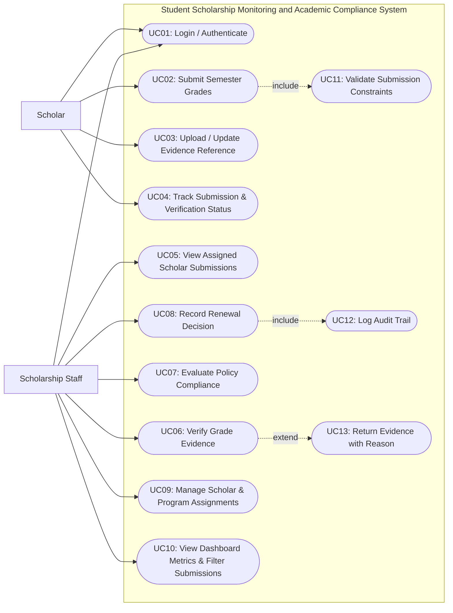
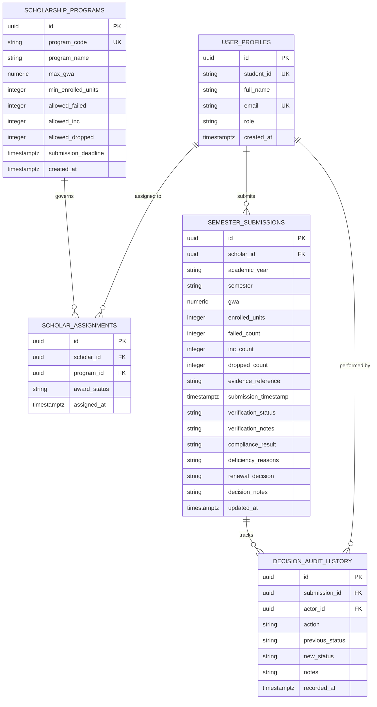
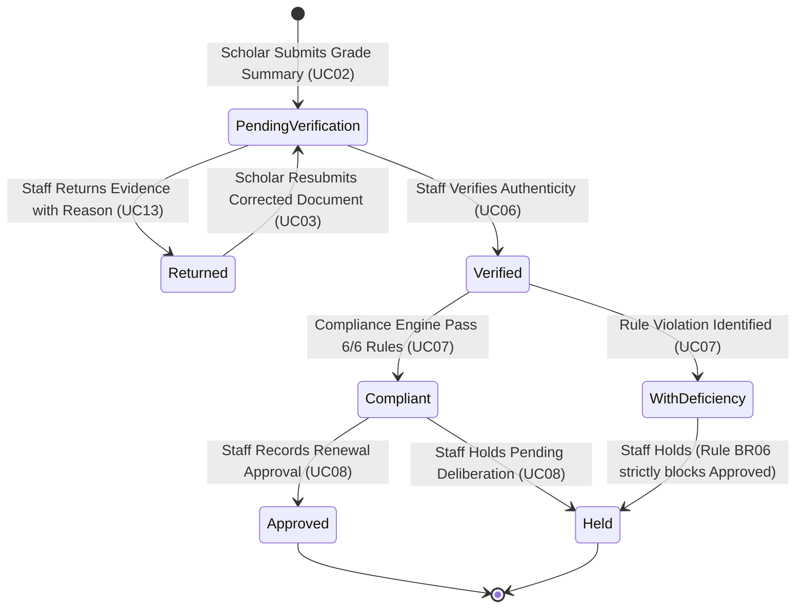
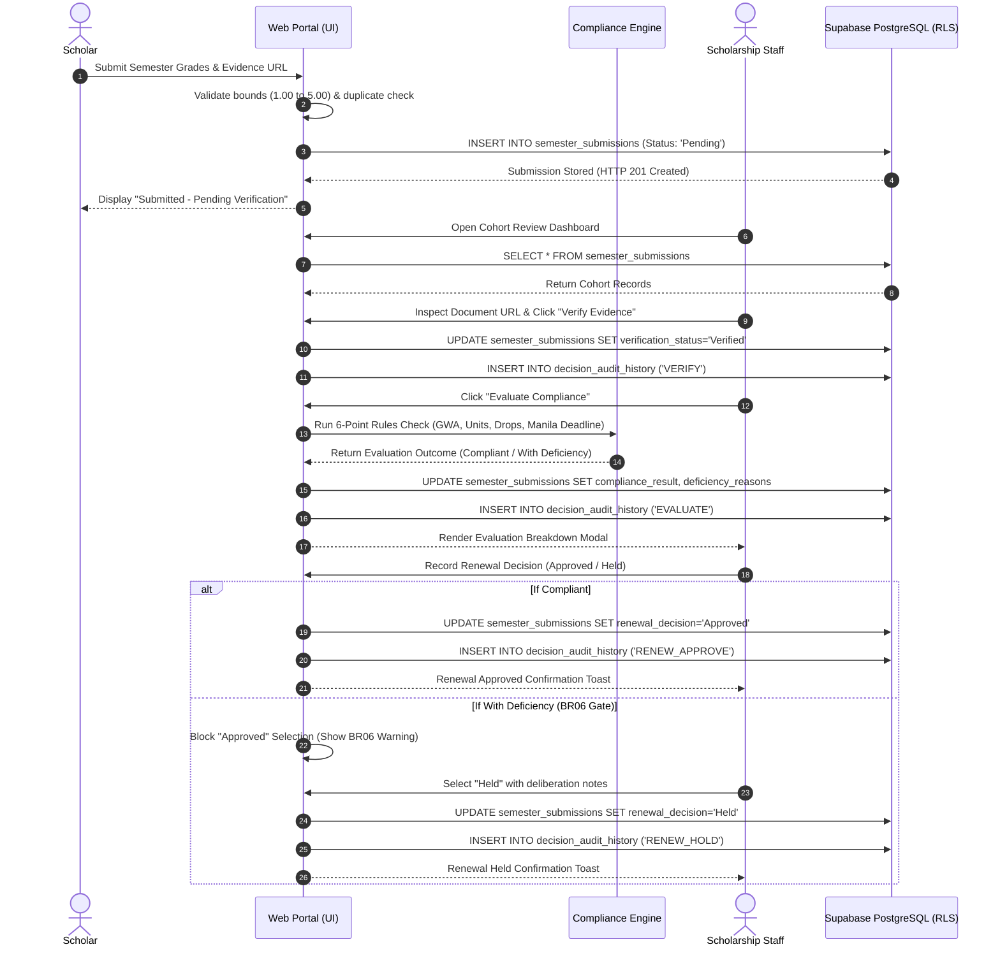

# Systems Analysis and Design
## Comprehensive Laboratory MIDTERM Examination — Section A
### Student Scholarship Monitoring and Academic Compliance System

- **Student Name:** JULIANNE TRISTAN E. DEQUINA  
- **Student ID:** M-006703  
- **Program & Year:** BSIT-3A  
- **Date:** October 20, 2026  
- **Submission Directory:** `SAD_Exam_Section_A_M-006703`  

---

# Part I: Analysis and Design

---

## A1. Investigation and Planning

### 1. Problem Statement
The Scholarship Office currently administers Merit Scholar and Community Scholar grants using fragmented spreadsheets, email attachments, and physical paper grade records. This decentralized process introduces duplicate semester entries, unverified student grade submissions, missed compliance deadlines, and inconsistent manual renewal determinations. Scholars lack real-time visibility into whether their submissions are received, verified, or returned for corrections. Concurrently, administrative staff suffer from processing backlogs and audit gaps due to the absence of centralized policy thresholds, automated compliance checks, and immutable evaluation logs.

### 2. Four Problem Cause-Effect Entries

| Entry ID | Root Cause | Direct Operational Effect | Systemic Consequence |
| :--- | :--- | :--- | :--- |
| **CE01** | Manual intake via emails, paper forms, and separate spreadsheets. | Duplicate semester submissions are created without primary key / unique constraint validation. | Data redundancy, conflicting academic metrics, and distorted scholar reporting. |
| **CE02** | Absence of a formal verification gateway prior to policy compliance checking. | Unverified or missing grade slips are evaluated alongside verified transcripts. | Erroneous renewal decisions, premature scholarship disbursements, or unjustified revocations. |
| **CE03** | Lack of centralized, database-persisted policy thresholds (thresholds hardcoded or estimated by staff). | Discrepancies between Merit and Community criteria (e.g., handling dropped subjects inconsistently). | Inequitable scholarship decisions, policy violations, and lack of institutional accountability. |
| **CE04** | No transparent status tracking or notification mechanism for scholars. | Scholars cannot verify if submissions are pending, verified, returned, or decided. | Severe communication delays, missed deadlines for corrections, and high administrative support volume. |

### 3. Scope and Exclusions

- **In Scope:**
  - Role-based authentication and database-enforced authorization for **Scholar** and **Scholarship Staff**.
  - Dynamic, database-driven scholarship program policy thresholds (`Merit Scholar` and `Community Scholar`).
  - Scholar academic summary submission with grade document reference (Google Drive / cloud link) and semester uniqueness validation.
  - Staff verification workflow allowing documents to be marked **Verified** or **Returned with Reason**.
  - Resubmission workflow for returned evidence returning the submission to **Pending Verification**.
  - Automated compliance evaluation engine executing program-specific rules (GWA boundary, minimum units, failed/INC/dropped allowances, deadline check in `Asia/Manila` time).
  - Staff-controlled renewal decision recording (**Approved** or **Held**), strictly gated by a **Compliant** evaluation.
  - Searchable and filterable administrative dashboard displaying cohort metrics (Total, Pending, Compliant, With Deficiency).
  - Persistent audit log capturing actor, action, timestamp, and decision notes for all state changes.

- **Exclusions:**
  - Live Registrar API synchronization (official grades remain under Registrar custody; this application processes student-reported summaries and supporting evidence).
  - Direct alteration of official institutional grades or scholastic transcripts.
  - Monetary disbursements, bank integrations, or bursar payment release execution.
  - Full formal legal appeals workflow (students correct evidence via resubmission rather than an appellate arbitration board).
  - External SMS gateway messaging.

### 4. Four Core Development Tasks

1. **Task T1 (Data Modeling & Security):** Design and deploy PostgreSQL schema in Supabase with normalized relations, unique composite constraints `(scholar_id, academic_year, semester)`, and Row-Level Security (RLS) policies enforcing backend isolation.
2. **Task T2 (Scholar Intake & Validation Pipeline):** Develop the Scholar portal interface and backend validation handler for semester grade summaries, upper/lower bounds (GWA `1.00`–`5.00`, non-negative units/counts), and duplicate submission rejections.
3. **Task T3 (Staff Verification & Compliance Engine):** Implement the Staff review module supporting document verification, reason logging for returns, automated policy evaluation against persisted program thresholds, and renewal gating.
4. **Task T4 (Dashboard, Audit History & Test Harness):** Construct the real-time metrics dashboard, search/filter controls, historical audit viewer, and the automated `TC01`–`TC10` verification test harness.

### 5. Two Technical & Operational Risks with Mitigation Responses

- **Risk R1: Backend Role Bypass / Unauthorized Record Tampering.**
  - *Risk Description:* A malicious scholar could manipulate client-side JavaScript or crafted REST calls to inspect other scholars' records or forge staff verification/approval states.
  - *Mitigation Response:* Enforce Row-Level Security (RLS) directly in PostgreSQL at the database layer. Scholars are granted `SELECT` only on rows where `scholar_id = auth.uid()` and cannot update `verification_status`, `compliance_result`, or `renewal_decision`. Verification and renewal updates require authenticated `staff` role membership.
- **Risk R2: Inconsistent Compliance Evaluations Caused by Timezone Mismatches.**
  - *Risk Description:* Submissions on the deadline boundary (e.g., `2026-10-30 17:00`) evaluated using local client browser clocks (UTC or other local zones) could be falsely marked late or on time.
  - *Mitigation Response:* Normalize all deadline comparisons strictly to `Asia/Manila` standard time (`UTC+8`). The submission timestamp is captured using server timestamps (`TIMESTAMPTZ` / Supabase `now()`), and deadline validation logic strictly formats both target and deadline strings in `Asia/Manila` ISO-8601 equivalents.

---

## A2. Stakeholders and Elicitation

### 1. Four Stakeholders and Distinction of Actual System Actors

| Stakeholder Name | Category | Actual System Actor? | Role Description & System Interaction |
| :--- | :--- | :--- | :--- |
| **Scholar** | Primary User | **YES (Actor)** | Directly interacts with the browser application to submit semester grade summaries, upload evidence references, review verification status, and resubmit corrected documents. |
| **Scholarship Staff** | Primary User | **YES (Actor)** | Directly interacts with the system to review evidence, mark verification (Verified/Returned), run policy compliance evaluations, record renewal decisions (Approved/Held), and inspect cohort metrics. |
| **University Registrar** | External Authority | **NO (Non-Actor)** | Custodian of official student records. Not an actor in this application because no live API is integrated; student-reported grades are cross-verified against grade document references. |
| **Scholarship Office Director / Auditor** | Business Owner / Beneficiary | **NO (Non-Actor)** | Relies on the integrity of audit logs, compliance reports, and aggregate renewal statistics for institutional oversight and board reporting, but does not execute daily operational system actions. |

### 2. Six Open-Ended Elicitation Questions

1. **EQ01 (Verification):** *"What specific supporting documents (e.g., certified true copy of grades, student portal screenshot, registrar grade slip) constitute acceptable grade evidence, and what standard reasons must be given when evidence is returned?"*
2. **EQ02 (Deadlines):** *"How should the system handle submissions submitted at the exact minute of the deadline versus one second/minute past `2026-10-30 17:00 Asia/Manila`, and what grace period or appeals route is legally recognized?"*
3. **EQ03 (Policy Exceptions):** *"Under what circumstances can a scholar with an evaluation flag of 'With Deficiency' (e.g., an incomplete grade due to university laboratory delays) be granted an exception, and who holds the administrative authority to record that exception?"*
4. **EQ04 (Role Access & Privacy):** *"What strict data isolation barriers must prevent scholars from viewing each other's grades, and what level of staff credentialing is required to perform irreversible scholarship decisions?"*
5. **EQ05 (Reporting & Auditing):** *"What real-time aggregate indicators and filtering capabilities (e.g., by academic year, semester, program type, deficiency category) do staff need most frequently during renewal deliberation meetings?"*
6. **EQ06 (Resubmission & Workflow State):** *"When a scholar resubmits evidence after a 'Returned' status, what happens to previously recorded staff notes, and how does the system ensure the submission is re-queued into the pending verification pipeline without data loss?"*

---

## A3. Requirements and Rules

### 1. Ten Testable Functional Requirements

- **FR01 (Role Authentication):** The system shall authenticate users and establish their role as either `Scholar` or `Scholarship Staff`.
- **FR02 (Role Data Isolation):** The system shall restrict authenticated Scholars to viewing and managing only their own profile and semester submission records.
- **FR03 (Staff Global Visibility):** The system shall allow authenticated Staff to view, filter, and inspect all scholar submissions across all assigned scholarship programs.
- **FR04 (Configurable Policy Retrieval):** The system shall retrieve scholarship thresholds (Max GWA, Min Units, Allowed Failed, Allowed INC, Allowed Drop, Deadline) dynamically from persisted database program records rather than hardcoded client logic.
- **FR05 (Semester Submission Intake):** The system shall allow Scholars to submit a semester record specifying Academic Year, Semester, GWA, Enrolled Units, Failed Count, INC Count, Dropped Count, and a Grade Document Reference URL.
- **FR06 (Input Validation & Duplicate Prevention):** The system shall validate that GWA is between `1.00` and `5.00` inclusive, all units and grade counts are non-negative integers, and reject duplicate submissions for an existing `(scholar_id, academic_year, semester)`.
- **FR07 (Evidence Verification Workflow):** The system shall allow Staff to transition a submission's verification status from `Pending` to either `Verified` or `Returned`, requiring a mandatory reason note if returned.
- **FR08 (Evidence Resubmission):** The system shall permit Scholars to update the grade document reference of a `Returned` submission, automatically resetting its status to `Pending` verification and logging the resubmission event.
- **FR09 (Automated Policy Compliance Evaluation):** The system shall execute a policy compliance check only on `Verified` submissions, flagging the record as `Compliant` if all program thresholds are satisfied or `With Deficiency` with explicit bulleted violation reasons.
- **FR10 (Controlled Renewal Decision):** The system shall allow Staff to record a renewal decision of `Approved` or `Held` with decision notes; the system shall strictly reject an `Approved` decision if the compliance result is not `Compliant`.

### 2. Four Measurable Non-Functional Requirements

- **NFR01 (Performance / Response Time):** The compliance evaluation engine and dashboard cohort queries shall compute and render results within **500 milliseconds** for a cohort of up to 1,000 scholar records under standard network conditions.
- **NFR02 (Security & Backend Enforcement):** Authorization shall be enforced at the database/API layer using PostgreSQL Row-Level Security (RLS) such that direct REST or GraphQL requests by a scholar to read another scholar's records return HTTP **403 Forbidden** or zero rows.
- **NFR03 (Reliability & Data Integrity):** The database schema shall guarantee transactional consistency (ACID); foreign key constraints, check constraints, and unique composite indexes shall prevent orphan records and duplicate semester entries with **100% enforcement**.
- **NFR04 (Usability & Accessibility):** The user interface shall be fully responsive across mobile (375px+), tablet, and desktop viewports, conforming to WCAG 2.1 Level AA standards with high-contrast text and keyboard-navigable forms.

### 3. Six Business Rules

- **BR01 (Grading Scale & Boundary Rule):** The academic grading scale spans `1.00` (highest excellence) to `5.00` (failing grade), where `3.00` is the passing threshold. Valid input must strictly fall in the range `1.00 <= GWA <= 5.00`. Lower GWA values represent superior academic standing.
- **BR02 (Program Specific Thresholds):**
  - **Merit Scholar:** Maximum GWA = `1.75`; Minimum Enrolled Units = `18`; Allowed Failed = `0`; Allowed INC = `0`; Allowed Dropped = `0`.
  - **Community Scholar:** Maximum GWA = `2.25`; Minimum Enrolled Units = `15`; Allowed Failed = `0`; Allowed INC = `0`; Allowed Dropped = `1`.
- **BR03 (Deadline & Lateness Rule):** Submissions for Academic Year 2026–2027 Semester 1 must be submitted on or before `2026-10-30 17:00:00 Asia/Manila`. Submissions timestamped after this deadline are classified as Late and automatically incur a `With Deficiency` compliance result.
- **BR04 (Verification Prerequisite Gate):** Only submissions with `verification_status = 'Verified'` are eligible for compliance evaluation and renewal determination. Submissions that are `Pending` or `Returned` cannot be evaluated or approved.
- **BR05 (Disqualification Separation Rule):** An evaluation result of `With Deficiency` does not automatically revoke or cancel a scholar's award status; the scholar award remains `Active` while the renewal decision is placed on `Held`.
- **BR06 (Renewal Approval Authority):** Only authenticated Scholarship Staff possess the authority to record renewal decisions. The system shall strictly prohibit approving any submission with a compliance result of `With Deficiency`.

---

## A4. UML Use Case Modeling

### Justification of Relationships:

1. **Include Relationship 1 (`UC02 Submit Semester Grades` -> `<<include>>` -> `UC11 Validate Submission Constraints`):**
   - *Justification:* Every single time a scholar attempts to submit semester grades, the system must execute mandatory input validation (GWA range `1.00`–`5.00`, non-negative integer counts, and semester uniqueness check). Submission cannot proceed or persist without this reusable validation behavior.
2. **Include Relationship 2 (`UC08 Record Renewal Decision` -> `<<include>>` -> `UC12 Log Audit Trail`):**
   - *Justification:* Institutional accountability dictates that whenever staff finalize an Approved or Held renewal decision, the system unconditionally creates an immutable audit record containing actor ID, previous status, new status, decision notes, and server timestamp.
3. **Extend Relationship (`UC13 Return Evidence with Reason` -> `<<extend>>` -> `UC06 Verify Grade Evidence`):**
   - *Justification:* During the verification flow, the base use case is evaluating the grade document. Only if staff determine the document is illegible, corrupted, or incomplete does the workflow branch conditionally into `UC13 Return Evidence with Reason` at the `[evidence_invalid]` extension point.

---

## A5. Detailed Use Cases and Data Design

### 1. Detailed Use Case Spec 1: Submit Grades

| Element | Specification |
| :--- | :--- |
| **Use Case ID** | **UC02** |
| **Use Case Name** | Submit Semester Grades |
| **Primary Actor** | Scholar |
| **Trigger** | Scholar navigates to the Submission Portal and clicks "Submit Semester Grades". |
| **Preconditions** | 1. Scholar is authenticated with valid credentials. 2. Scholar has an assigned active scholarship program record (`Merit Scholar` or `Community Scholar`). |
| **Postconditions** | A new submission record is created with status `Pending`, timestamped in `Asia/Manila` time, and visible to staff for verification. |
| **Linked IDs** | **FR01, FR02, FR05, FR06, BR01, BR03, TC01, TC07** |

#### Main Success Flow:
1. Scholar accesses the Grade Submission form.
2. System populates Scholar ID, Name, and Assigned Program (`Merit Scholar` or `Community Scholar`).
3. Scholar selects Academic Year (e.g., `2026-2027`) and Semester (e.g., `Semester 1`).
4. Scholar inputs academic summary metrics: GWA, Enrolled Units, Failed Count, Incomplete (INC) Count, Dropped Count.
5. Scholar provides the public URL / reference to the supporting grade document.
6. Scholar submits the form.
7. System validates input bounds (`1.00 <= GWA <= 5.00`, integer counts >= 0) and verifies no prior submission exists for this scholar in this academic year and semester combination.
8. System records the submission with `verification_status = 'Pending'`, `compliance_result = 'Pending Verification'`, and `created_at = CURRENT_TIMESTAMP`.
9. System displays a success confirmation badge with submission reference ID and status.

#### Alternative & Exception Flows:
- **Alt Flow 4a (Correction of Returned Submission):**
  - If a submission previously received `Returned` status from staff, the form enters correction mode. Scholar updates the grade reference link and resubmits. System updates the record, resets status to `Pending`, and logs the resubmission.
- **Exception Flow 7a (Duplicate Semester Submission):**
  - If a submission already exists for the selected academic year and semester, the system rejects the transaction and displays: *"Error: A submission for Academic Year 2026-2027 Semester 1 already exists."*
- **Exception Flow 7b (Invalid Boundary Input):**
  - If GWA is outside `1.00`–`5.00` (e.g., `0.50`) or counts are negative, system halts submission, highlights offending fields, and displays: *"Validation Error: GWA must be between 1.00 and 5.00; counts must be non-negative integers."*

---

### 2. Detailed Use Case Spec 2: Evaluate Compliance

| Element | Specification |
| :--- | :--- |
| **Use Case ID** | **UC07** |
| **Use Case Name** | Evaluate Policy Compliance |
| **Primary Actor** | Scholarship Staff |
| **Trigger** | Staff clicks "Evaluate Compliance" on a verified scholar submission. |
| **Preconditions** | 1. Staff user is authenticated with administrative staff role. 2. Target submission has `verification_status = 'Verified'`. |
| **Postconditions** | Submission `compliance_result` is updated to either `Compliant` or `With Deficiency`, with comprehensive audit reasons stored. |
| **Linked IDs** | **FR03, FR04, FR07, FR09, FR10, BR02, BR03, BR04, BR05, TC01, TC02, TC03, TC04, TC05, TC06** |

#### Main Success Flow:
1. Staff selects a submission from the pending evaluation list.
2. System retrieves the persisted `scholarship_programs` policy record corresponding to the scholar's assigned program.
3. System verifies that `verification_status == 'Verified'`.
4. System executes policy compliance rules against the submission metrics:
   - Check 1: `GWA <= program.max_gwa`
   - Check 2: `enrolled_units >= program.min_enrolled_units`
   - Check 3: `failed_count <= program.allowed_failed`
   - Check 4: `inc_count <= program.allowed_inc`
   - Check 5: `dropped_count <= program.allowed_dropped`
   - Check 6: `submission_timestamp <= program.submission_deadline` (`2026-10-30 17:00:00 Asia/Manila`)
5. All checks pass; system marks `compliance_result = 'Compliant'`.
6. System enables the "Approve Renewal" button for staff and stores the compliance audit trail.

#### Alternative & Exception Flows:
- **Alt Flow 4a (Policy Violations Detected):**
  - If one or more policy checks fail, system compiles specific deficiency reasons (e.g., *"GWA 1.76 exceeds 1.75 limit"*, *"14 units is below required 15"*, *"Submitted 1 minute late"*).
  - System marks `compliance_result = 'With Deficiency'`.
  - System disables "Approve Renewal", restricts available actions to "Hold Renewal", and persists deficiency reasons.
- **Exception Flow 3a (Unverified Submission Evaluation Gate):**
  - If staff attempts to trigger evaluation on a record where `verification_status != 'Verified'` (e.g., status is `Pending` or `Returned`), system blocks execution with: *"Compliance evaluation blocked: Evidence document must be Verified first."*

---

### 4. Academic Submission Lifecycle State Machine

### 5. End-to-End System Execution Sequence Diagram

### 6. Relational Data Dictionary & Constraint Specifications

| Table Name | Column Name | Data Type | Constraint / Key | Description & Integrity Rule |
| :--- | :--- | :--- | :--- | :--- |
| **`user_profiles`** | `id` | `UUID` | `PRIMARY KEY` | Unique account identifier linked to Supabase Auth. |
| | `student_id` | `VARCHAR(30)` | `UNIQUE, NOT NULL` | Student number or staff badge (e.g. `A01`, `STAFF-001`). |
| | `email` | `VARCHAR(255)` | `UNIQUE, NOT NULL` | Authenticated email address. |
| | `role` | `VARCHAR(20)` | `CHECK IN ('scholar', 'staff')` | Role-based authorization barrier (FR01, NFR02). |
| **`scholarship_programs`** | `id` | `UUID` | `PRIMARY KEY` | Unique program identifier. |
| | `program_code` | `VARCHAR(20)` | `UNIQUE, NOT NULL` | Standard identifier: `MERIT` or `COMMUNITY`. |
| | `max_gwa` | `NUMERIC(3,2)` | `CHECK (max_gwa BETWEEN 1.00 AND 5.00)` | Upper limit for compliant standing (1.75 Merit / 2.25 Community). |
| | `min_enrolled_units` | `INTEGER` | `CHECK (min_enrolled_units >= 0)` | Minimum academic load (18 Merit / 15 Community). |
| | `allowed_dropped` | `INTEGER` | `CHECK (allowed_dropped >= 0)` | Permitted drop allowance (0 Merit / 1 Community). |
| | `submission_deadline`| `TIMESTAMPTZ` | `NOT NULL` | Asia/Manila cutoff boundary (`2026-10-30 17:00:00+08`). |
| **`scholar_assignments`** | `scholar_id` | `UUID` | `FK -> user_profiles(id)` | Linked scholar account. |
| | `program_id` | `UUID` | `FK -> scholarship_programs(id)`| Assigned policy governing this scholar. |
| | `award_status` | `VARCHAR(20)` | `CHECK IN ('Active', 'Under Review', 'Revoked')` | Award state (BR05 separation rule). |
| **`semester_submissions`**| `id` | `UUID` | `PRIMARY KEY` | Submission record identifier. |
| | `(scholar_id, academic_year, semester)` | `COMPOSITE` | `UNIQUE CONSTRAINT` | **Guarantees zero duplicate semester submissions (TC07, FR06).** |
| | `gwa` | `NUMERIC(3,2)` | `CHECK (gwa BETWEEN 1.00 AND 5.00)` | Grade weighted average input bounds. |
| | `verification_status`| `VARCHAR(20)` | `CHECK IN ('Pending', 'Verified', 'Returned')` | Workflow gate state (BR04). |
| | `compliance_result` | `VARCHAR(30)` | `CHECK IN ('Pending Verification', 'Compliant', 'With Deficiency')` | Policy compliance outcome. |
| | `renewal_decision` | `VARCHAR(20)` | `CHECK IN ('Pending', 'Approved', 'Held')` | Renewal determination gated by BR06. |
| **`decision_audit_history`**| `id` | `UUID` | `PRIMARY KEY` | Unique audit log entry. |
| | `submission_id` | `UUID` | `FK -> semester_submissions(id)`| Target submission record. |
| | `actor_id` | `UUID` | `FK -> user_profiles(id)` | Performing user ID. |
| | `action` | `VARCHAR(30)` | `NOT NULL` | Audit event: `VERIFY`, `RETURN`, `EVALUATE`, `RENEW_APPROVE`, `RENEW_HOLD`, `RESUBMIT`. |
| | `recorded_at` | `TIMESTAMPTZ` | `DEFAULT CURRENT_TIMESTAMP` | Server-side immutable timestamp. |

---

## A6. Traceability Matrix

| Req ID | Actor | Use Case | Business Rule | Implemented Screen / Function | Test Case & Expected Result |
| :--- | :--- | :--- | :--- | :--- | :--- |
| **FR01** | Scholar & Staff | UC01 Authenticate | Rule Access Enforcement | `loginView / handleAuthSession()` | **TC08:** Scholar restricted strictly to own records; Staff gains administrative verification actions. |
| **FR05** | Scholar | UC02 Submit Grades | BR01, BR03 Deadline Policy | `submitGradeForm / handleGradeSubmission()` | **TC01:** Submission recorded with timestamp; Compliant status at boundary GWA 1.75 and deadline. |
| **FR06** | Scholar | UC02 & UC11 Validate Input | BR01 Valid Ranges & Unique Submissions | `validateSubmissionInput()` | **TC07:** Rejects duplicate semester submission and invalid GWA (e.g. 0.50) with explicit validation error. |
| **FR07** | Staff | UC06 Verify Evidence & UC13 Return | BR04 Verification Gate | `renderVerificationControls() / handleVerifyEvidence()` | **TC06 & TC09:** Block evaluation until verified; returned submission resubmission returns status to Pending. |
| **FR09** | Staff | UC07 Evaluate Compliance | BR02 Configurable Thresholds, BR03 | `complianceEngine.evaluateSubmission()` | **TC02 to TC05:** Identifies GWA excess, dropped subject variance, multiple deficiencies, and late penalties. |
| **FR10** | Staff | UC08 Record Renewal Decision | BR05 Separation, BR06 Renewal Authority | `handleRenewalDecision()` | **TC10:** Staff can approve compliant records and hold deficient ones; scholars have zero renewal authority. |

### Planned Requirements Identified as Out of Scope / Not Implemented
1. **Live Registrar System Integration:** Official grade pulling via external REST API is excluded by examination mandate; grade summaries are entered by the student and authenticated via uploaded document references.
2. **Automated SMS Gateway Notifications:** SMS dispatching upon status change is omitted; replaced with real-time in-app status updates and persistent audit logs.
3. **Bursar Financial Disbursement Module:** The application strictly manages scholarship compliance and renewal authority; monetary payment disbursements are governed externally by the university finance office.
